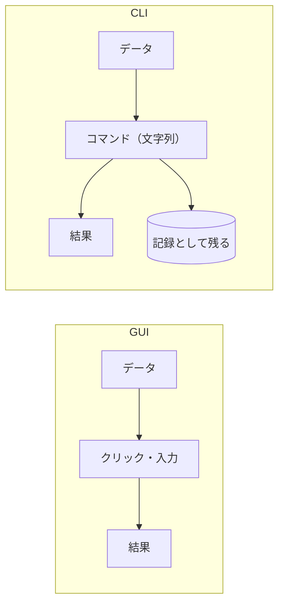
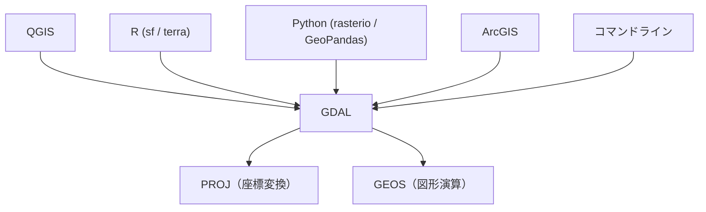
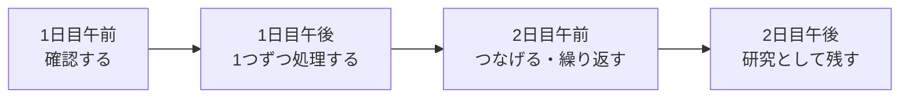

# 1. オリエンテーション

**形式：講義（約40分）**

## この時間の問い

> なぜ、わざわざ黒い画面で地図を扱うのか？

## なぜCLIなのか？

GUIで十分に地図は作れます。それでもCLIを学ぶ理由は3つです。

| 理由 | GUIだと | CLIだと |
|------|---------|---------|
| **再現性** | 操作の記録が残らない | コマンドが、そのまま記録になる |
| **自動化** | ファイル100個なら100回操作する | ループ1行で100個処理する |
| **研究との接続** | 論文の方法に「QGISで処理した」としか書けない | 実行したコマンドを付録・リポジトリに置ける |

詳しくは [過程が残る道具を使う](../process.md) を参照。

## GUIとの違い

- GUI：**操作** が処理を決める。操作は消える。
- CLI：**文字列** が処理を決める。文字列は保存・コピー・比較・共有できる。

!!! question "考えてみよう"
    卒論・修論で「この図をどう作ったか」を1年後に聞かれたら、答えられますか？

## オープンソースGISの位置づけ

- GDAL/OGR、PROJ、GEOS は、多くのGISソフトが内部で共有している **オープンソースの基盤ライブラリ** です。
- OSGeo（Open Source Geospatial Foundation）がこれらのプロジェクトを支援しています。
- CLIでGDALを使うことは、**GISソフトの「中身」を直接触ること** です。QGISで覚えた操作は QGIS でしか使えませんが、GDALで覚えたことは R でも Python でもクラウドでも使えます。

## 2日間の流れ

