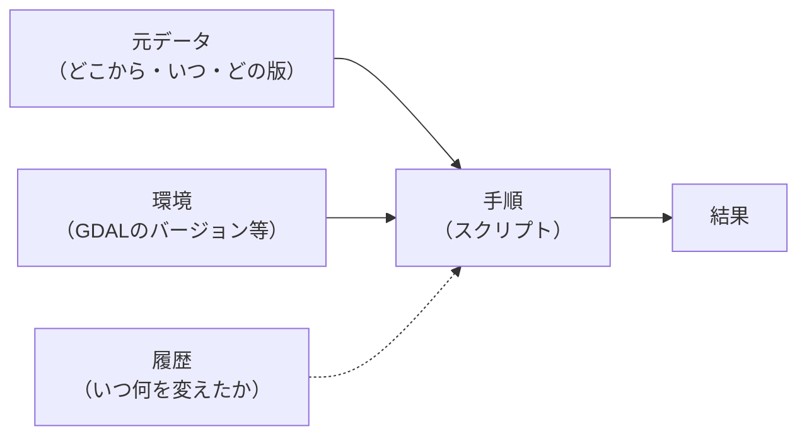

# 6. 再現可能なワークフローとは？

**形式：講義（約30分）＋議論（約30分）**

## この時間の問い

> 「これをもう一度出してください」と言われたとき、何を渡せばよいか？

[過程が残る道具を使う](../process.md) で示した判定基準を、研究の場面に当てはめます。

## 6.1 研究における再現性

| 用語 | 意味 | GISでの例 |
|------|------|-----------|
| 再現（reproducible） | **同じデータ・同じ手順** で同じ結果が出る | 自分のスクリプトを他人が実行して同じ図が出る |
| 追試（replicable） | **別のデータ** で同じ手順を試して同じ傾向が出る | 岡山の手順を鳥取に適用する |

GISの研究で再現が難しくなる典型例：

- 元データの版が分からない（「国土数値情報の行政区域」の **何年版**？）
- 座標系・リサンプリングなどの設定が記録されていない
- 途中で **手作業の修正** が入っている
- ソフトのバージョンで結果が変わる

## 6.2 記録可能な処理フロー

渡すべきものは、次の4つです。



### 推奨するフォルダ構成

```text
my-project/
├── README.md            # 何の研究か、どう実行するか
├── data/
│   ├── raw/             # 元データ（手で触らない）
│   ├── work/            # 中間（消してよい）
│   └── output/          # 結果（消してよい）
├── scripts/
│   ├── 01_prepare.sh
│   ├── 02_stats.sh
│   └── run_all.sh       # これ1本で最初から最後まで
├── environment.yml      # 環境の定義
└── .gitignore           # data/work, data/output を除外
```

!!! danger "🔴 判定基準"
    `data/work/` と `data/output/` を **消してから** `run_all.sh` を実行して、同じ結果が出るか。
    出なければ、どこかに「渡せない手順」が混じっています。

### 元データの記録

`data/raw/README.md` に、少なくとも次を書きます。

- 名称・提供者・URL
- 取得日・版（年度）
- ライセンス

### 環境の記録

```bash
gdalinfo --version > data/output/env.txt
conda env export --from-history > environment.yml
```

## 6.3 バージョン管理の考え方

Git は「ファイルの変更履歴」を残す道具です。研究では、**手順（スクリプト）の履歴** を残すために使います。

```bash
git init
git add README.md scripts/ environment.yml .gitignore
git commit -m "市町村別標高統計の初版"

# スクリプトを修正したら
git diff                     # 何を変えたか確認
git commit -am "リサンプリングを cubic に変更"
git log --oneline            # 履歴
```

| Gitに入れるもの | Gitに入れないもの |
|-----------------|-------------------|
| スクリプト、README、環境定義 | 大きな元データ（入手方法を README に書く） |
| 小さな設定ファイル | 中間ファイル・結果（再生成できるから） |

## 議論（30分）

!!! question "グループで話し合おう"
    1. 自分の卒論・修論の図表のうち、**今すぐ再現できないもの** はどれか。何が欠けているか。
    2. 研究室で引き継いだデータに、出所が分からないものはないか。
    3. 「全部を再現可能にする」のは現実的か。どこまでやれば十分か。
