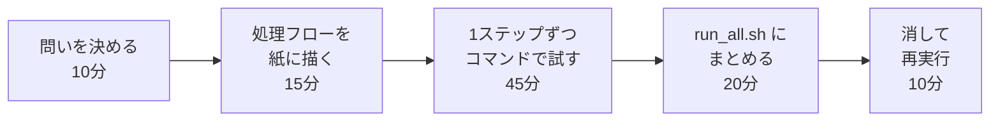

# 7. 小規模プロジェクト演習

**形式：グループ演習（約100分）＋発表（約20分）**

## ルール

- **CLIのみ** で解析フローを構築する（結果の確認にQGISを使うのは可）
- `run_all.sh` を1本実行すれば、`data/raw/` から最終成果物まで再生成できること
- 他グループが **あなたたちのリポジトリをクローンして実行できる** こと
- 生成AIの利用は可。ただし、AIが書いたコマンドもスクリプトに保存し、自分たちで実行・確認すること

## テーマ（1つ選ぶ）

=== "A. 地形と市町村"

    **問い：** 岡山県の市町村のうち、急傾斜地の割合が高いのはどこか？

    - ヒント：`gdaldem slope` → `gdal_calc.py` で閾値処理 → 市町村ごとに集計
    - 成果物：市町村別の急傾斜地割合 CSV、傾斜区分図（COG）

=== "B. 土地利用と標高"

    **問い：** 標高帯ごとに、土地利用の構成はどう違うか？

    - ヒント：DEMを標高帯で区分 → 土地利用メッシュと重ね合わせ → SQLite 方言の SQL で集計
    - 成果物：標高帯×土地利用のクロス集計 CSV

=== "C. 観測点の周辺環境"

    **問い：** 各気象観測所の周辺（半径1km）は、どんな土地利用・地形か？

    - ヒント：CSV → 点 → 平面直角座標系へ → `ST_Buffer` → 土地利用・DEMを集計
    - 成果物：観測所ごとの周辺環境 CSV

=== "D. 自由テーマ"

    自分の研究に近いテーマを設定してよい（講師に相談）。

## 進め方

1. **処理フローを先に紙に描く**（入力 → 処理 → 出力の箱と矢印）
2. 1ステップずつ、ターミナルで試して `gdalinfo` / `ogrinfo` で確認する
3. 動いたコマンドをスクリプトに移す
4. `data/work/` と `data/output/` を消して、`run_all.sh` で再生成できるか確かめる
5. `git commit` する

## 提出物チェックリスト

- [ ] `README.md`：問い・使用データ・実行方法・結果の要約
- [ ] `scripts/run_all.sh`：これ1本で最後まで動く
- [ ] `data/raw/README.md`：元データの出典・版・取得日
- [ ] 成果物（CSV、図）
- [ ] Git の履歴が残っている

## 発表（1グループ3分）

- 問いと答え（1枚の図か表）
- 処理フロー図
- **一番つまずいた箇所と、どう解決したか**

## 相互検証

発表後、他グループのリポジトリを1つ選んで実行し、同じ結果が出るか確かめます。
