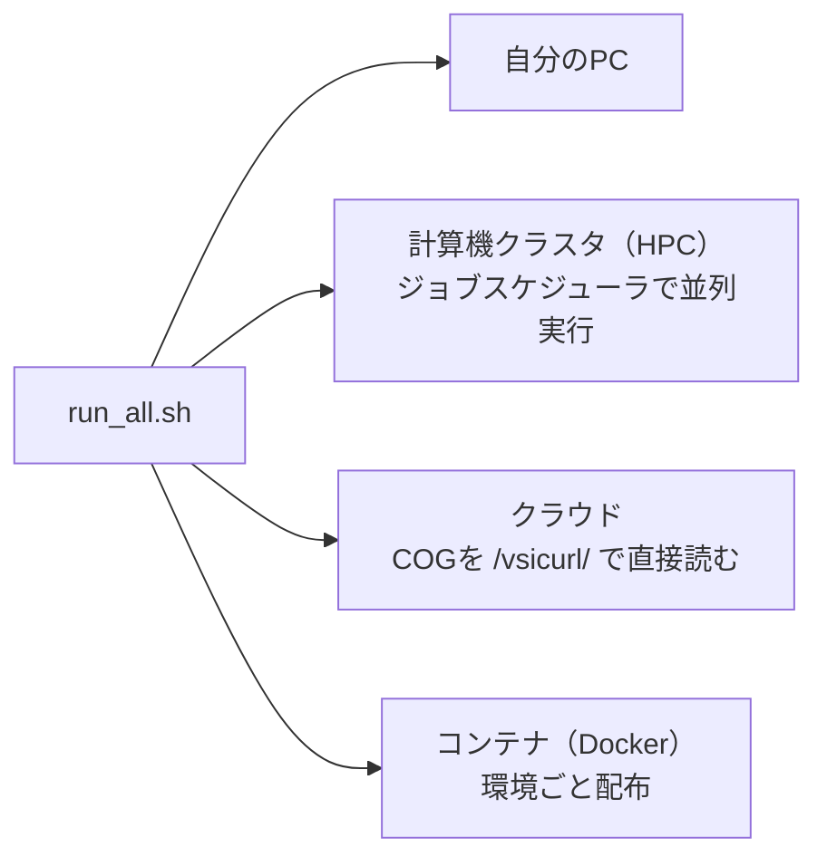

# 8. 研究接続ディスカッション

**形式：講義（約15分）＋議論（約30分）**

## 8.1 自身の研究でどう使えるか

!!! question "個人ワーク（10分）"
    自分の研究で、次に当てはまる作業を書き出してください。

    - 同じ処理を **何度も** 繰り返している作業
    - データが **増えたら** やり直しになる作業
    - **1年後の自分** が再現できなさそうな作業

## 8.2 Python / R との接続

CLIで覚えた GDAL は、そのまま Python や R から使えます。**同じエンジンを、別の入口から触っているだけ** です。

=== "Python"

    ```python
    from osgeo import gdal
    gdal.UseExceptions()

    # 従来コマンドと同じ指定
    gdal.Warp("dem_6673.tif", "dem.tif", dstSRS="EPSG:6673", resampleAlg="bilinear")

    # 新CLIと同じ指定（GDAL 3.11+）
    gdal.Run(["raster", "reproject"], input="dem.tif", output="dem_6673.tif",
             dst_crs="EPSG:6673")
    ```

=== "R"

    ```r
    library(terra)
    dem <- rast("dem.tif")
    dem_6673 <- project(dem, "EPSG:6673", method = "bilinear")
    writeRaster(dem_6673, "dem_6673.tif")

    # sf / terra には GDAL のコマンドを直接呼ぶ関数もある
    sf::gdal_utils("warp", "dem.tif", "dem_6673.tif",
                   options = c("-t_srs", "EPSG:6673", "-r", "bilinear"))
    ```

使い分けの目安：

| 場面 | 向いている道具 |
|------|----------------|
| ファイル単位の変換・切り出し・結合 | CLI |
| 統計解析・モデリング・作図 | R / Python |
| 両方 | CLIで前処理 → R/Pythonで解析、を1本のスクリプトでつなぐ |

## 8.3 HPC・クラウドへの展開可能性

CLIで書いた手順は、**実行する場所を選びません**。



- **HPC**：`for` ループをジョブ配列に置き換えるだけで、数千タイルを並列処理できる
- **クラウド**：COG なら、ダウンロードせずに必要な範囲だけ読める（`/vsicurl/`、`/vsis3/`）
- **コンテナ**：環境を丸ごと定義して渡せる（この講義の Codespaces もその一例）

```bash
# 例：クラウド上のDEMから、必要な範囲だけ切り出す（ダウンロード不要）
gdal_translate -projwin 133.8 34.8 134.0 34.6 \
  /vsicurl/https://copernicus-dem-30m.s3.amazonaws.com/Copernicus_DSM_COG_10_N34_00_E133_00_DEM/Copernicus_DSM_COG_10_N34_00_E133_00_DEM.tif \
  data/work/okayama_city_dem.tif
```

## 議論（30分）

!!! question "グループで話し合おう"
    1. 8.1 で書き出した作業のうち、CLI化すると一番効果が大きいものは？
    2. 研究室の他のメンバーと手順を共有するには、何が必要か？
    3. CLI化 **しない方がよい** 作業はあるか？
