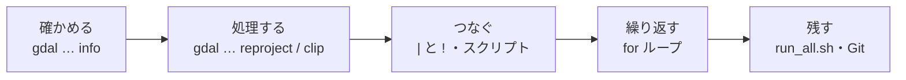

# 9. まとめ

**形式：講義（約20分）**

## CLIを「道具」ではなく「研究基盤」として捉える

| 道具として見ると | 研究基盤として見ると |
|------------------|----------------------|
| GUIより速い | 処理の過程が、記録としてそのまま残る |
| たくさんのファイルを処理できる | データが増えても、同じ手順で何度でもやり直せる |
| 玄人っぽい | 他人が確かめられる、引き継げる、論文に載せられる |

## 2日間で扱ったこと

## もう一度、判定基準

> **「これをもう一度出してください」と言われて、手順を人に渡せるか。**

この問いに「はい」と答えられる形で、研究を進めてください。
CLIはそのための、最も確実な方法の一つです。

## この後の学び方

- [GDAL 公式ドキュメント](https://gdal.org/)：各コマンドのページに例が豊富
- [GDAL 新CLI 移行ガイド](https://gdal.org/en/stable/programs/migration_guide_to_gdal_cli.html)
- [The Carpentries](https://carpentries.org/)：シェル・Git の入門教材
- [OSGeo日本支部](https://www.osgeo.jp/)、FOSS4G：オープンソースGISのコミュニティ

## 振り返りシート

!!! question "提出"
    1. 2日間で一番「強い」と感じたCLIの使い方は？
    2. 自分の研究で、最初にCLI化する作業は？
    3. まだ怖い・分からないところは？
